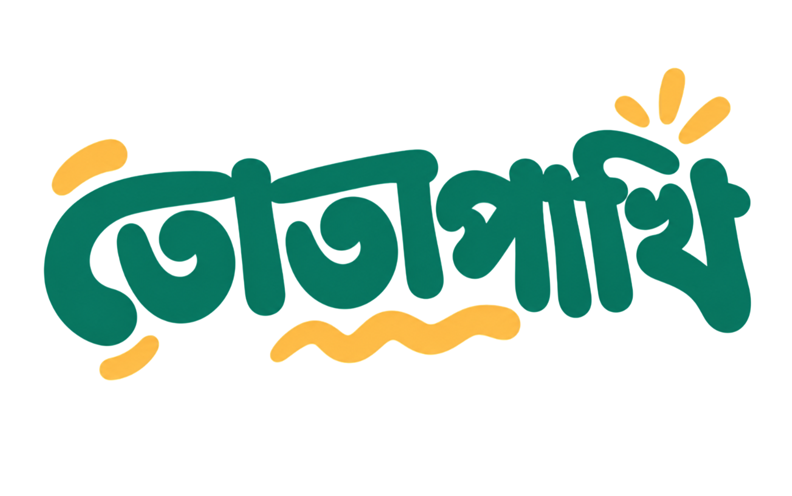

# তোতাপাখি (Totapakhi)

<div align="center">
  

  <p><strong>Bengali Impromptu Speaking Practice & Topic Engine</strong></p>
  <p>বাংলা ভাষায় উপস্থিত বক্তৃতা, ইন্টারভিউ প্রস্তুতি ও আড্ডার চর্চার জন্য একটি ইন্টারেক্টিভ প্ল্যাটফর্ম।</p>

  <p>
    <a href="https://totapakhi.byjubayer.com"><strong>🌐 Live Demo</strong></a> •
    <a href="#-key-features">Key Features</a> •
    <a href="#-tech-stack">Tech Stack</a> •
    <a href="#-getting-started">Getting Started</a> •
    <a href="#-shortcuts">Keyboard Shortcuts</a>
  </p>

  <p>
    
    
    
    
    
    
  </p>
</div>

---

## 📖 Overview

**তোতাপাখি (Totapakhi)** is an open-source impromptu speaking practice application designed to help Bengali speakers sharpen their spontaneous speaking, interview storytelling, debate agility, and conversational wit.

With a physics-driven slot-machine reel, an interactive pull lever, synthesized retro sound effects (powered by the Web Audio API), conversation starter prompts, and an interactive countdown drill timer, Totapakhi provides a distraction-free offline-first environment for public speaking drills.

---

## ✨ Key Features

- **🎰 Physics-Based Topic Slot Machine**:
  - Smooth inertia deceleration with spring-settle physics driven by `requestAnimationFrame`.
  - Guaranteed landing novelty (prevents duplicate appearances in visible strip).
  - Responsive dynamic text wrapping and font-size scaling.

- **🕹️ Mechanical Pull-Lever Interaction**:
  - Interactive draggable lever with angle clamping, velocity mapping, and spring-back animation.
  - Accompanied by desktop and mobile fallback spin buttons.

- **🎯 Diverse Topic Categories & Gender Filtering**:
  - **হযবরল (Surprise)**: Random mix across all categories.
  - **পাল্টা যুক্তি (Worst Takes / Contrarian Arguments)**: Defend eccentric opinions with strong logic.
  - **১ মিনিটের পিচ (1-Minute Elevator Pitches)**: Pitch bizarre inventions and startup ideas.
  - **গভীর ভাবনা (Deep Thoughts)**: Introspective philosophical prompts and personal reflections.
  - **স্মৃতি ও আড্ডা (Memories & Adda)**: Nostalgic childhood, school, and hostel life stories.
  - Gender-tailored filter options (`সবাই / উরাধুরা`, `বেডা মানুষ`, `বেডি মানুষ`).

- **💡 "কথা শুরু করার ভাবনা" (Hints & Conversation Hooks)**:
  - Contextual talking points and structural starter hints rendered after each spin.

- **⏱️ Precision Speech Drill Timer**:
  - Circular SVG progress ring visualization with countdown indicators.
  - Direct inline contentEditable digit editing (minutes & seconds).
  - Quick `+0:30` / `−0:30` time adjustment buttons and auditory cues.

- **🔊 Pure Web Audio API Sound Effects**:
  - Zero external `.mp3` / `.wav` assets — all clicks, reel ticks, clunks, chime sequences, and alarm sirens are synthesized dynamically using oscillators, filters, and white noise buffers.

- **💾 Offline & Persistent**:
  - Runs 100% in the client browser with zero backend requirements.
  - Preserves selected categories, gender preferences, and active modes in `localStorage`.

---

## ⌨️ Keyboard Shortcuts

| Shortcut | Action | Where |
| :--- | :--- | :--- |
| <kbd>Space</kbd> | Spin the topic slot machine | Topic Reel Screen |
| <kbd>Enter</kbd> | Launch timer with current topic | Topic Reel Screen (after landing) |
| <kbd>Esc</kbd> | Return to topics reel | Timer Screen |

---

## 🛠️ Tech Stack

- **Framework**: [React 19](https://react.dev/)
- **Language**: [TypeScript](https://www.typescriptlang.org/) (Strict mode, ES2022)
- **Bundler & Build Tool**: [Vite 8](https://vite.dev/)
- **Styling**: [Tailwind CSS v4](https://tailwindcss.com/) with `@tailwindcss/vite`
- **UI Primitives**: [Base UI (`@base-ui/react`)](https://base-ui.com/) + [shadcn](https://ui.shadcn.com/)
- **Icons**: [Lucide React](https://lucide.dev/)
- **Typography**: Bengali fonts ([Baloo Da 2](https://fontsource.org/fonts/baloo-da-2), [Noto Sans Bengali](https://fontsource.org/fonts/noto-sans-bengali)) & [Inter](https://fontsource.org/fonts/inter)
- **Audio**: Web Audio API (Synthesizer & DSP)
- **Package Manager**: [Bun](https://bun.sh/) (or npm / pnpm / yarn)

---

## 📁 Project Structure

```text
totapakhi-client/
├── public/                 # Static assets (favicons, badges, images)
├── src/
│   ├── assets/             # Topics JSON dataset and category definitions
│   │   ├── categories.ts   # Category metadata and Bengali labels
│   │   └── topics.json     # Curated question database
│   ├── components/
│   │   ├── interview/      # Interview preparation panel (Coming Soon)
│   │   ├── timer/          # Circular countdown drill timer
│   │   ├── topics/         # Reel slot-machine & mechanical Lever
│   │   └── ui/             # Reusable UI primitives (Button, Dropdown, Tabs, etc.)
│   ├── hooks/
│   │   ├── usePersistence.ts # Generic localStorage sync hook
│   │   └── useReel.ts        # Physics engine for slot-machine animation
│   ├── lib/
│   │   ├── sounds.ts       # Synthesized Web Audio API sound generator
│   │   └── utils.ts        # Class merging utilities (`cn`)
│   ├── types/
│   │   └── index.ts        # Core TypeScript interfaces & types
│   ├── App.tsx             # Root application & tab routing
│   ├── index.css           # Global typography & design system tokens
│   ├── main.tsx            # Application entrypoint
│   └── vite-env.d.ts       # Vite environment declarations
├── components.json         # shadcn UI configuration
├── eslint.config.js        # ESLint flat configuration (with typescript-eslint)
├── tsconfig.json           # TypeScript configuration
└── vite.config.ts          # Vite build & alias configuration
```

---

## 🚀 Getting Started

### Prerequisites

Ensure you have [Bun](https://bun.sh/) (recommended) or [Node.js](https://nodejs.org/) (v18+) installed.

### 1. Clone the repository

```bash
git clone https://github.com/jubayers-r/totapakhi-client.git
cd totapakhi-client
```

### 2. Install dependencies

```bash
bun install
# or: npm install
```

### 3. Start development server

```bash
bun run dev
# or: npm run dev
```

The application will be available at `http://localhost:5173`.

### 4. Build for production

```bash
bun run build
# or: npm run build
```

This performs a type-check with `tsc` and outputs the optimized static bundle into `dist/`.

### 5. Lint and Typecheck

```bash
# Typecheck
bun x tsc --noEmit

# Lint
bun run lint
```

---

## ✍️ Adding Custom Topics

Topics are organized in `src/assets/topics.json`. You can contribute or add new topics under any category:

```json
{
  "id": "wt_101",
  "topic": "যুক্তি দিন: বাসের জ্যামে বসে থাকা মানুষের জন্য সবচেয়ে সেরা ফ্রি মেডিটেশন",
  "category": "worsttake",
  "gender": "neutral",
  "hints": [
    "তাড়াহুড়ো করে কোনো লাভ নেই মেনে নেওয়া",
    "বাইরের জগত দেখা ও ভাবার সুযোগ",
    "চরম বাস্তবতার মাঝে ধৈর্য শেখা"
  ]
}
```

- **`gender`**: `"neutral"` (included in all filters), `"male"` (included in All & Male), or `"female"` (included in All & Female).
- **`hints`**: Optional 1 to 3 bullet points showing ideas on how to approach the topic.

---

## 📄 License

This project is open-source under the [MIT License](LICENSE).

---

<div align="center">
  <p>Crafted with 💚 by <a href="https://linktr.ee/aatagache.totapakhi"><strong>Jubayer</strong></a></p>
  <p><em>তোতাপাখি — মুখে কথা ফুটবেই!</em></p>
</div>
